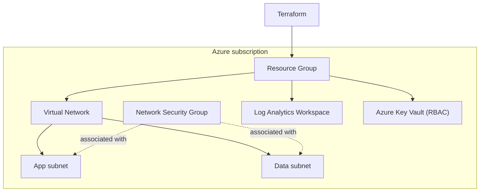

# Azure Landing Zone Foundation with Terraform

A hands-on, entry-level Azure infrastructure project that provisions a small, reusable landing-zone foundation. It demonstrates Infrastructure as Code (IaC), network segmentation, centralized logging, Key Vault configuration, and Git-based change management.

> **Scope note:** This is a learning/demo foundation, not a complete enterprise Azure Landing Zone or a production-ready implementation of Microsoft's Cloud Adoption Framework. Extend it with management groups, policy assignments, hub-and-spoke connectivity, private endpoints, centralized identity, and CI/CD controls before using it in an enterprise.

## Architecture



## What this project creates

- One Azure Resource Group.
- One Virtual Network with separate application and data subnets.
- One Network Security Group associated with both subnets, with an explicit inbound deny rule for Internet traffic.
- One Log Analytics Workspace for a centralized logging foundation.
- One Azure Key Vault configured for Azure RBAC authorization and soft delete/purge protection.
- Random suffix for a globally unique Key Vault name.

No VM, database, public IP, secret, or billable compute workload is created by this baseline.

## Repository structure

```text
azure-landing-zone-terraform/
├── modules/
│   ├── networking/
│   │   ├── main.tf
│   │   ├── variables.tf
│   │   └── outputs.tf
│   │   ├── main.tf
│   │   ├── variables.tf

│   └── security/
│       ├── main.tf
│       ├── variables.tf
      
├── architecture/
│   └── architecture.md
├── examples/
│   └── terraform.tfvars
├── main.tf
├── variables.tf
├── .gitignore
└── README.md
```

## Prerequisites

- An Azure subscription and permission to create resource groups, networking, Log Analytics workspaces, and Key Vaults.
- Azure CLI.
- Terraform CLI (1.5 or later).
- Git.

## Authenticate to Azure

```bash
az login
az account set --subscription "<YOUR_SUBSCRIPTION_ID>"
az account show --output table
```

Terraform uses the Azure CLI authentication context. For CI/CD, use a securely configured workload identity or service principal; never commit credentials.

## Configure

Copy the example variables file:

```bash
cp examples/terraform.tfvars.example terraform.tfvars
```

Edit `terraform.tfvars` and set a unique Key Vault prefix. If you want to restrict Key Vault access to your current public IP, set `key_vault_allowed_ip_cidrs` to your IP in `/32` format.

On Windows PowerShell:

```powershell
Copy-Item examples/terraform.tfvars.example terraform.tfvars
```

`terraform.tfvars` is ignored by Git. Do not put passwords, tokens, or other secrets in it.

## Deploy

```bash
terraform init
terraform fmt -recursive
terraform validate
terraform apply tfplan
```

Review the plan carefully before applying. Azure resources may incur charges, especially if you extend this project.

## Verify

```bash
az group show --name <RESOURCE_GROUP_NAME> --output table
az network vnet show --resource-group <RESOURCE_GROUP_NAME> --name <VNET_NAME> --output table
az monitor log-analytics workspace list --resource-group <RESOURCE_GROUP_NAME> --output table
az keyvault list --resource-group <RESOURCE_GROUP_NAME> --output table
```

Use the Terraform outputs to obtain the exact names.

## Clean up

When finished, remove resources created by this project:

```bash
terraform destroy
```

Review the destroy plan before confirming. Key Vault purge protection can prevent immediate permanent deletion; follow your organization's retention requirements.

## Security notes

- No credentials or real secrets belong in this repository.
- Key Vault uses Azure RBAC authorization, soft delete, and purge protection.
- Key Vault network ACLs default to deny. Add only trusted public IP CIDRs if you need access from your workstation.
- The NSG explicitly denies inbound Internet traffic. Add narrowly scoped rules only when a workload requires them.
- This starter does not configure private endpoints, Defender for Cloud, Azure Policy, management groups, or diagnostic settings for every resource. These are useful next enhancements.

## Suggested next enhancements

1. Add Terraform remote state in a dedicated Storage Account with state locking and restricted access.
2. Add Azure Policy initiatives and resource tagging standards.
3. Add private endpoints and private DNS for Key Vault and data services.
4. Add diagnostic settings to send platform logs to Log Analytics.
5. Add an Azure DevOps YAML pipeline with `fmt`, `validate`, plan review, and approval-gated apply.
6. Add Checkov or tfsec scanning and document the findings.

## Author

**Aniruddha Kurhe**  
GitHub: https://github.com/aniruddha868

This project is intended for learning, portfolio demonstration, and interview discussion.
